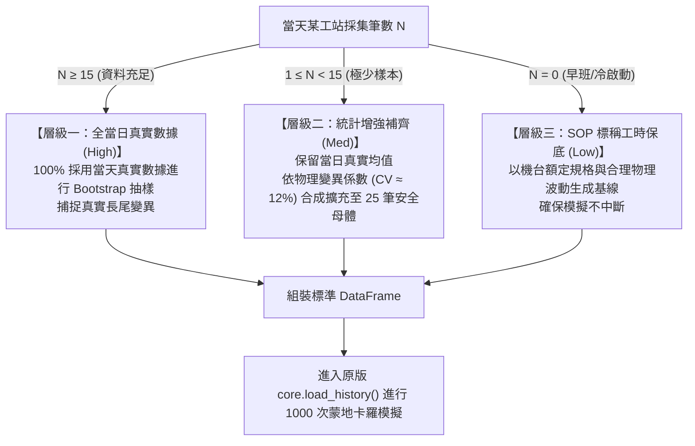

# 通用生產離散事件模擬器 —— 動態當日資料與少樣本適應版 使用說明書

---

## 📖 目錄
1. [系統概述與升級背景](#一系統概述與升級背景)
2. [核心機制：無歷史資料下的三層守護體系](#二核心機制無歷史資料下的三層守護體系)
3. [快速上手指南（三種操作模式）](#三快速上手指南三種操作模式)
4. [10 秒快速對比實驗（新舊版本差異）](#四10-秒快速對比實驗新舊版本差異)
5. [未來如何連動 SQL 資料庫](#五未來如何連動-sql-資料庫)
6. [常見問題與常見設定調整 (FAQ)](#六常見問題與常見設定調整-faq)

---

## 一、系統概述與升級背景

### 1.1 傳統離散事件模擬 (DES) 的盲點
傳統的生產模擬器（如原版 `core.py`）假設工廠已經累積了長期的穩定歷史數據（每站至少 15~30 筆以上）。
然而在實際工廠數位化與日常生產中，常見以下情境：
* **每日採集量不均**：某天產能滿載獲得 30 筆，某天因換線或小批量只獲得 5 筆。
* **工站進度斷層**：早班剛開工時，前段工站 ST01 已產出 3~5 筆，但後段瓶頸站 ST03 或組裝站 ST05 仍是 **0 筆**。
* **原版程式直接報錯死當**：原版程式只要任何一個工站缺乏歷史加工時間，就會直接跳出 `ConfigError: 工站 STxx 沒有有效歷史加工時間`，導致排程模擬完全無法進行。

### 1.2 本版本之核心價值
* **100% 保持原有程式架構**：完全不更動 `production_simulator/core.py` 的核心演算法，保證既有功能向下相容。
* **外圍自適應守護層（Daily Data Guard）**：在資料進入模擬核心前，自動完成「異常清洗、統計增強、SOP 保底」，讓系統在 0 筆或 5 筆的極端條件下依然能產出高可靠度的排程甘特圖。
* **預留 SQL 資料庫介面**：已建立標準抽象介面，未來可無縫切換至 MySQL / PostgreSQL / SQL Server。

---

## 二、核心機制：無歷史資料下的三層守護體系

當系統僅能拿到當天動態資料時，會依據各工站當日的採集筆數 $N$ 自動切換策略：



### 各層級運作細節：
1. **層級一（充沛資料）**：
   - 當天採集 $\ge 15$ 筆（如 28~30 筆）。
   - 母體已具備統計代表性，直接使用真實數據進行 Bootstrap（有放回重抽樣）。
2. **層級二（少量資料，如 3~5 筆）**：
   - 若直接拿 3 筆抽樣，會造成分佈斷裂（例如抽樣永遠只在 3 個數字打轉，且一筆卡料異常會被放大至 33% 機率）。
   - **解法**：計算當日真實平均值 $\hat{\mu}$，保留真實採集紀錄，並根據製造業經驗物理變異係數（$CV = 10\% \sim 15\%$）合成補足至 25 筆。
3. **層級三（零資料，0 筆）**：
   - 當天尚未開工的工站，啟用工程預設之 SOP 標稱時間（可於設定檔調整），注入 $\pm 10\%$ 的物理隨機波動，維持模擬推進。

---

## 三、快速上手指南（三種操作模式）

### 模式 A：使用 Streamlit 網頁版（視覺化操作）

1. 雙擊執行專案資料夾下的 **`start_windows.bat`**。
2. 在終端機選單中直接按 **Enter**（預設為 1，啟動網頁版）。
3. 瀏覽器開啟 `http://localhost:8501`。
4. 在網頁上方的檔案上傳區下方，您會看見：
   > **`🛡️ 啟用動態當日資料守護模式（自動處理 5 筆少樣本與 0 筆工站）`**
5. **將開關打勾開啟**，接著上傳當日的少筆數 CSV（例如 `examples/today_5records_test.csv`）。
6. 網頁會自動展開 **「📊 當日各工站數據品質與處理策略診斷」**，點擊 **「執行模擬」** 即可產出甘特圖與完工時間指標！

---

### 模式 B：一鍵快速測試（不用開瀏覽器）

若生管或工程人員只想快速在命令列看結果：
* 直接雙擊專案目錄下的 **`start_dynamic_simulator.bat`**。
* 系統會自動以少資料（3~5 筆 / 0 筆）情境進行 1000 次模擬，並在終端機中完整列印診斷報表。

---

### 模式 C：進階命令列指令 (CLI)

開啟 PowerShell 並切換至專案路徑：
```powershell
cd "c:\Users\Zack\Downloads\production_simulator_students\production_simulator_students"

# 1. 執行少資料/冷啟動情境 (sparse)
.\.venv\Scripts\python.exe dynamic_daily_simulator.py --mode sparse

# 2. 執行充沛資料情境 (plenty)
.\.venv\Scripts\python.exe dynamic_daily_simulator.py --mode plenty

# 3. 指定您今天自訂的 CSV 檔案
.\.venv\Scripts\python.exe dynamic_daily_simulator.py --csv "C:\路徑\當日生產日誌.csv"

# 4. 調整模擬次數 (例如 2000 次) 與固定種子
.\.venv\Scripts\python.exe dynamic_daily_simulator.py --mode sparse --runs 2000 --seed 123
```

---

## 四、10 秒快速對比實驗（新舊版本差異）

在 `examples/` 資料夾中附帶了一份極端測試檔：**`examples/today_5records_test.csv`**。
該檔案內容如下（全檔僅 5 筆，且 **ST03 與 ST05 為 0 筆**）：
```csv
station_id,duration_sec,status
ST01,3.1,completed
ST01,3.4,completed
ST02,6.5,completed
ST02,7.2,completed
ST04,4.9,completed
```

### 實驗對比：
* **舊版行為（關閉守護模式）**：
  上傳該檔案後，系統**立刻崩潰跳出紅字**：
  `ConfigError: 工站 ST03 沒有有效歷史加工時間（需 > 0）`
  👉 **產線完全停擺，無法評估完工時間。**
* **新版行為（開啟守護模式 🛡️）**：
  零報錯！系統自動顯示：
  - `ST01`：今日 2 筆，以今日均值 3.25 秒進行統計增強至 25 筆。
  - `ST03`：今日 0 筆，自動以 SOP 標稱時間 10.5 秒保底。
  👉 **點擊「執行模擬」，順利產出 1000 次蒙地卡羅排程甘特圖與 P90 保守風險交期！**

---

## 五、未來如何連動 SQL 資料庫

在 `dynamic_daily_simulator.py` 中，已經為您預留了 `SqlDataProvider` 介面。

### 步驟 1：建議的 SQL 資料表結構 (DDL)
```sql
CREATE TABLE production_logs (
    log_id INT AUTO_INCREMENT PRIMARY KEY,
    round_id VARCHAR(50),
    station_id VARCHAR(50) NOT NULL,
    product_id VARCHAR(50) NOT NULL,
    start_time DATETIME(3),
    finish_time DATETIME(3) NOT NULL,
    duration_sec DECIMAL(10, 2) NOT NULL,
    status VARCHAR(20) DEFAULT 'completed',
    created_at TIMESTAMP DEFAULT CURRENT_TIMESTAMP
);

-- 加速當日查詢的索引
CREATE INDEX idx_station_finish ON production_logs (station_id, finish_time DESC);
```

### 步驟 2：修改 `dynamic_daily_simulator.py` 中的連線
打開 `dynamic_daily_simulator.py` 約第 130 行，替換為您的 SQL 連線：
```python
# 例如 MySQL：
provider = SqlDataProvider("mysql+pymysql://帳號:密碼@localhost:3306/生產資料庫")
today_df = provider.fetch_today_records()

# 接著直接執行模擬：
run_dynamic_simulation(input_data_df=today_df)
```

### 步驟 3：全自動排程執行
利用 Windows **「工作排程器」** 或 Linux **Crontab**，設定每天固定時間（如中午 12:00、下午 17:00）執行腳本，模擬結果會自動存入 `outputs/dynamic_run/stats.json`，亦可直接寫回資料庫。

---

## 六、常見問題與常見設定調整 (FAQ)

### Q1: 如何修改各工站的「SOP 標稱保底工時」？
開啟 `dynamic_daily_simulator.py`，在第 27 行修改 `DEFAULT_SOP_TIMES` 字典：
```python
DEFAULT_SOP_TIMES: Dict[str, float] = {
    "ST01": 3.2,    # 工站 ST01 的標稱規格秒數
    "ST02": 6.8,    # 工站 ST02 的標稱規格秒數
    "ST03": 10.5,   # 工站 ST03 的標稱規格秒數
    "ST04": 5.0,
    "ST05": 8.5,
}
```

### Q2: 完工時間指標中的「平均值」、「P50」與「P90」該如何看？
* **平均總完工時間 (Mean)**：統計期望值，適合評估長期設備稼動率。
* **中位數 (P50)**：正常有一半機率可在此時間內完成，代表典型作業情境。
* **90 百分位數 (P90)**：**生管承諾客戶交期的最佳基準**！代表考慮了機台波動、小延遲等風險後，產線有 90% 的把握能在此時間內完工交付。

### Q3: 每次模擬的結果檔存放在哪裡？
所有檔案皆自動存入專案目錄下的 `outputs/dynamic_run/`：
* `data_quality_report.csv`：各站資料品質健康度與處理策略診斷表。
* `example_schedule.csv`：排程工單明細表（開工秒數、完工秒數）。
* `station_summary.csv`：各工站工時累計與設備稼動率。
* `stats.json`：平均值、P50、P90 核心統計數據。
